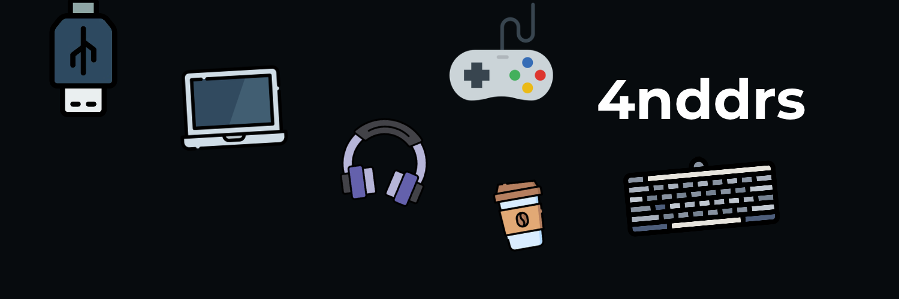

<p align="center">
  
</p>


<h1 align="center">4nddrs</h1>
<p align="center">
  <code>systems engineer</code> · <code>backend</code> · <code>linux-first</code>
</p>

<p align="center">
  <a href="https://github.com/4nddrs">github ↗</a>
  &nbsp;·&nbsp;
  <a href="https://www.linkedin.com/in/4nddrs">linkedin ↗</a>
  &nbsp;·&nbsp;
  <a href="https://x.com/4nddrs">x ↗</a>
  &nbsp;·&nbsp;
  <a href="mailto:4nddrs.dev@gmail.com">email ↗</a>
  &nbsp;·&nbsp;
  <a href="https://4nddrs.github.io">website ↗</a>
</p>


<h3><code>❯ bat about.md</code></h3>

- I build software close to the system — from backend infrastructure and CLI tools to automation and applied AI.

- I enjoy understanding how things work, designing reliable systems, and building software that makes them work better.

- Solving hard problems for people I care about.


<h4><code>❯ bat philosophy.md</code></h4>

- <em>Solving hard problems for people I care about.</em>

</br>

<h3><code>❯ bat stack.md</code></h3>

```text

~/stack

├── backend/      Python · Go · FastAPI · Flask

├── data/         PostgreSQL · MongoDB · Firebase

├── infra/        Linux · Docker · Kubernetes · Bash

├── applied-ai/   PyTorch · OpenCV · Computer Vision

├── frontend/     TypeScript · React · Astro · Vite

└── workflow/     Git · Neovim · pi · OpenCode · T3 Code

```

</br>

<h3><code>❯ git log --experience --graph</code></h3>

```text

* 2026 (HEAD)   Ninescale      — Software Developer · Robotics

* 2026          4nddrs         — Software Architect & Developer (Freelance)

* 2025          Paramo Games   — Software Developer (Intern)

* 2025          EDUBO          — Software Developer (Intern)

```

</br>

<h3><code>❯ bat interests.md</code></h3>

```markdown
01  agentic systems
    orchestration · tool-use

02  applied AI & robotics
    real-world AI · world models

03  developer tooling
    CLI · harnesses · automation

04  systems architecture
    distributed systems · reliability

05  linux & automation
    reproducible environments · dotfiles

06  software engineering
    clean architecture · testing
```
